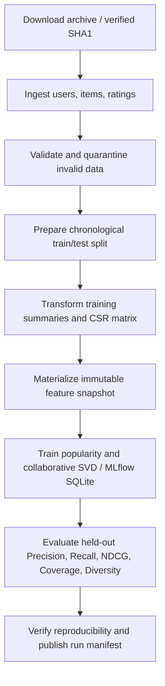

# Milestone 6 — Prefect orchestration and reproducibility

## Architecture and dependency contract



`flows/recommendation_flow.py` uses **Prefect 3** tasks named `01-download`, `02-ingest`, through `08-evaluate`. Each task has a *Prefect state dependency* (`wait_for`) on the prior task. The final `.result()` propagates task failures to the parent flow. No stage can run successfully unless its predecessor completes. Prefect UI displays task runs with their states. Download is retried twice (5-second delay); validation and other deterministic data stages have **zero retries** so they cannot hide data-quality or model failures.

The original `all`, `milestone2`, `full`, `milestone3`, `full3`, `milestone4`, `full4`, `recommend`, `milestone5`, and `full5` commands remain unchanged. New aliases `milestone6`, `full6`, and `orchestrate` run **all eight stages** under Prefect. `--require-clean` is enforced for these commands by design. MLflow's default is **SQLite**, not the deprecated filesystem tracking store.

## macOS first run

Run from the root of the extracted project. Python 3.11 or 3.12 recommended for package compatibility; Prefect >=3.4.25 documents Python 3.14 support, but verify that the *entire dependency set* installs in your environment.

```bash
python3 -m venv .venv
source .venv/bin/activate
python -m pip install --upgrade pip
python -m pip install -r requirements.txt
python -m pytest -v
```

Open **Terminal A** and start the Prefect server:

```bash
source .venv/bin/activate
prefect server start --host 127.0.0.1
```

Open **Terminal B** in the same repository:

```bash
source .venv/bin/activate
export PREFECT_API_URL=http://127.0.0.1:4200/api
python -m scripts.pipeline milestone6 --tracking-uri sqlite:///mlflow.db
```

Alternatively, `python -m scripts.pipeline full6 --tracking-uri sqlite:///mlflow.db` (same pipeline). For a locally available official archive, add `--archive "$HOME/Downloads/ml-100k.zip"`. There is **no** `--no-mlflow` requirement for the real assignment; keep MLflow enabled for final evidence.

Open Prefect UI at `http://127.0.0.1:4200` and locate the latest `dm4ml-recommendation-end-to-end` flow run. It should show **Completed**, with each of the eight task runs completed, ordered by dependency.

Run the workflow **a second time** to demonstrate reproducibility:

```bash
python -m scripts.pipeline milestone6 --tracking-uri sqlite:///mlflow.db
cat reports/orchestration/latest_run.json
cat reports/orchestration/reproducibility_baseline.json
```

Expected on an unchanged dataset and configuration: `reproducibility.status` = `matched_previous_run`. The first successful run records `baseline_created`. If source or configuration changes, it records `new_input_baseline`. If the *same* inputs/config generate different numeric model/evaluation outputs, it **fails** with `Reproducibility drift`. MLflow-generated run IDs and wall-clock timestamps are intentionally excluded from comparison.

## Evidence and output files

```
reports/orchestration/
  latest_run.json                 # status, stages, timing, parameters
  reproducibility_baseline.json  # input and output SHA256 fingerprints
  runs/<run_id>/
    01_download.json             # individual stage receipts
    02_ingest.json
    03_validate.json
    04_prepare.json
    05_transform.json
    06_features.json
    07_train.json
    08_evaluate.json
    run_report.json              # successes/failures and provenance
```

The fingerprints include the exact train/test CSV SHA256 values, feature snapshot ID, model *array contents* hashes and full held-out metric scores. Model serialization containers, output timestamps and MLflow run IDs are deliberately omitted from the repeatability comparison. This does not replace independent validation of data split, results or external system behavior.

## Required evidence screenshots for final PDF

1. Terminal B: `ORCHESTRATION OK`, eight completed stages, run ID, and reproducibility status.
2. Prefect UI: **Flow Runs** page with `dm4ml-recommendation-end-to-end` and green **Completed** status; capture the visible time and name.
3. Prefect UI: select the run and open its **task-run details** showing all eight stage tasks and successful state/dependencies. The UI may render graph/task names differently between Prefect versions.
4. Terminal: `cat reports/orchestration/latest_run.json` and second-run `matched_previous_run`.
5. MLflow UI: `mlflow ui --backend-store-uri sqlite:///mlflow.db --port 5000`; show two model runs with evaluation metrics.
6. Terminal: `python -m pytest -v` final test summary.

Screenshots must be genuine results from **your macOS run**. Fixture-based Python tests do not constitute evidence that the live Prefect server and UI work with MovieLens 100K.

## Failure policy and troubleshooting

- **No Prefect module**: install dependencies with `python -m pip install -r requirements.txt` in the active virtual environment; `python -c 'import prefect; print(prefect.__version__)'`.
- **Prefect server unreachable**: start `prefect server start`, confirm `PREFECT_API_URL=http://127.0.0.1:4200/api` in Terminal B, and check port 4200 availability.
- **Legacy MLflow filesystem error**: use `--tracking-uri sqlite:///mlflow.db`. Do not use `MLFLOW_ALLOW_FILE_STORE=true` or delete historical runs as the primary solution.
- **Validation fails/quarantines rows**: downstream stages stop; inspect `reports/validation/` and `data/errors/`. Correct the source or schema rules, do not suppress errors.
- **Insufficient evaluation cohort**: the flow fails; inspect the chronological split, relevance threshold and held-out labels. Do not fabricate metric values.
- **Repeated flow changed results**: check input/config fingerprints, seed, source dataset, NumPy/SciPy versions; retain the failed receipt for audit.
- **Partial artifacts after failure**: stages are not transactional. Do not interpret partially written outputs as a successful pipeline. Inspect `latest_run.json` and rerun once the root cause is resolved.
- **Python 3.14 Pandas/NumPy deprecation warnings**: upstream non-fatal compatibility warnings, not test errors. Consider Python 3.11/3.12 if other packages have installation issues.

## Limitations

- This is a **local** Prefect workflow, not a deployed 24/7 agent. For scheduled unattended execution, a dedicated Prefect deployment/worker and durable server are required.
- Retry applies to downloads only, not to downstream deterministic stages.
- Local filesystem outputs and SQLite backend are appropriate for a coursework pipeline; a multi-worker production system would use transactionally managed storage and a production-grade database.
- The workflow must complete with your actual data before claiming a successful Prefect screenshot or measured full-run reproducibility.
